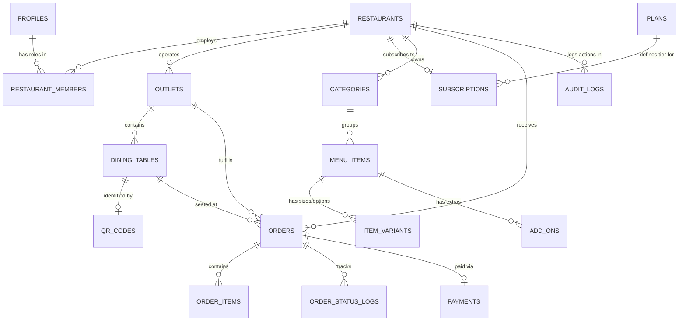

# MeraResto — Multi-Tenant Database Architecture & Schema Specification
**Engine:** PostgreSQL (Supabase)  
**Security Model:** Mandatory Row Level Security (RLS) & Role-Based Access Control (RBAC)  
**Tenant Partition Key:** `restaurant_id UUID`  
**Version:** 2.0.0  

---

## 1. Multi-Tenant Relational Schema Design



---

## 2. Table Specifications & Column Definitions

### 1. `profiles`
User metadata extending Supabase `auth.users`.
```sql
CREATE TABLE public.profiles (
    id UUID PRIMARY KEY REFERENCES auth.users(id) ON DELETE CASCADE,
    full_name TEXT NOT NULL,
    avatar_url TEXT,
    phone TEXT,
    is_platform_admin BOOLEAN DEFAULT false,
    created_at TIMESTAMPTZ DEFAULT now(),
    updated_at TIMESTAMPTZ DEFAULT now()
);
```

### 2. `plans`
SaaS subscription tiers managed by Super Admin.
```sql
CREATE TABLE public.plans (
    id UUID PRIMARY KEY DEFAULT gen_random_uuid(),
    name TEXT NOT NULL UNIQUE,          -- 'Starter', 'Pro Hospitality', 'Enterprise'
    slug TEXT NOT NULL UNIQUE,          -- 'starter', 'pro', 'enterprise'
    description TEXT,
    price_monthly NUMERIC(10, 2) NOT NULL,
    price_annual NUMERIC(10, 2) NOT NULL,
    max_outlets INT DEFAULT 1,
    max_tables_per_outlet INT DEFAULT 15,
    max_menu_items INT DEFAULT 100,
    kds_enabled BOOLEAN DEFAULT true,
    analytics_enabled BOOLEAN DEFAULT false,
    is_active BOOLEAN DEFAULT true,
    created_at TIMESTAMPTZ DEFAULT now()
);
```

### 3. `restaurants`
Core tenant record representing the dining establishment.
```sql
CREATE TABLE public.restaurants (
    id UUID PRIMARY KEY DEFAULT gen_random_uuid(),
    name TEXT NOT NULL,
    slug TEXT NOT NULL UNIQUE,          -- Subdomain/URL slug (e.g. 'balkumari-restaurant')
    tagline TEXT,
    logo_url TEXT,
    banner_url TEXT,
    primary_color TEXT DEFAULT '#0E8388',
    currency TEXT DEFAULT 'INR',
    currency_symbol TEXT DEFAULT '₹',
    contact_email TEXT,
    contact_phone TEXT,
    is_active BOOLEAN DEFAULT true,
    created_at TIMESTAMPTZ DEFAULT now(),
    updated_at TIMESTAMPTZ DEFAULT now()
);
CREATE INDEX idx_restaurants_slug ON public.restaurants(slug);
```

### 4. `restaurant_members`
Role-Based Access Control (RBAC) mapping staff to restaurants.
```sql
CREATE TYPE public.member_role AS ENUM (
    'owner',        -- Full control over restaurant, billing & staff
    'manager',      -- Menu, orders, tables, reports
    'chef',         -- KDS live orders & station updates
    'waiter',       -- Order placement assistance & table service
    'cashier'       -- Bill settlement & payments
);

CREATE TABLE public.restaurant_members (
    id UUID PRIMARY KEY DEFAULT gen_random_uuid(),
    restaurant_id UUID REFERENCES public.restaurants(id) ON DELETE CASCADE NOT NULL,
    user_id UUID REFERENCES public.profiles(id) ON DELETE CASCADE NOT NULL,
    role public.member_role NOT NULL DEFAULT 'manager',
    created_at TIMESTAMPTZ DEFAULT now(),
    UNIQUE(restaurant_id, user_id)
);
CREATE INDEX idx_restaurant_members_lookup ON public.restaurant_members(restaurant_id, user_id);
```

### 5. `subscriptions`
Tenant billing status and plan assignment.
```sql
CREATE TYPE public.subscription_status AS ENUM (
    'trialing', 'active', 'past_due', 'canceled', 'unpaid'
);

CREATE TABLE public.subscriptions (
    id UUID PRIMARY KEY DEFAULT gen_random_uuid(),
    restaurant_id UUID REFERENCES public.restaurants(id) ON DELETE CASCADE UNIQUE NOT NULL,
    plan_id UUID REFERENCES public.plans(id) NOT NULL,
    status public.subscription_status DEFAULT 'trialing',
    current_period_start TIMESTAMPTZ DEFAULT now(),
    current_period_end TIMESTAMPTZ NOT NULL,
    cancel_at_period_end BOOLEAN DEFAULT false,
    razorpay_subscription_id TEXT,
    created_at TIMESTAMPTZ DEFAULT now(),
    updated_at TIMESTAMPTZ DEFAULT now()
);
```

### 6. `outlets`
Physical branches or outlets belonging to a restaurant.
```sql
CREATE TABLE public.outlets (
    id UUID PRIMARY KEY DEFAULT gen_random_uuid(),
    restaurant_id UUID REFERENCES public.restaurants(id) ON DELETE CASCADE NOT NULL,
    name TEXT NOT NULL,                 -- e.g. 'Main Branch', 'Downtown Outpost'
    address TEXT NOT NULL,
    city TEXT NOT NULL,
    state TEXT,
    postal_code TEXT,
    phone TEXT,
    is_active BOOLEAN DEFAULT true,
    created_at TIMESTAMPTZ DEFAULT now()
);
CREATE INDEX idx_outlets_restaurant ON public.outlets(restaurant_id);
```

### 7. `categories`
Categorical hierarchy for menu items.
```sql
CREATE TABLE public.categories (
    id UUID PRIMARY KEY DEFAULT gen_random_uuid(),
    restaurant_id UUID REFERENCES public.restaurants(id) ON DELETE CASCADE NOT NULL,
    outlet_id UUID REFERENCES public.outlets(id) ON DELETE CASCADE,
    name TEXT NOT NULL,
    sort_order INT DEFAULT 0,
    is_active BOOLEAN DEFAULT true,
    created_at TIMESTAMPTZ DEFAULT now()
);
CREATE INDEX idx_categories_restaurant ON public.categories(restaurant_id);
```

### 8. `menu_items`
Dishes and beverages served by the restaurant.
```sql
CREATE TABLE public.menu_items (
    id UUID PRIMARY KEY DEFAULT gen_random_uuid(),
    restaurant_id UUID REFERENCES public.restaurants(id) ON DELETE CASCADE NOT NULL,
    category_id UUID REFERENCES public.categories(id) ON DELETE SET NULL,
    name TEXT NOT NULL,
    description TEXT,
    base_price NUMERIC(10, 2) NOT NULL CHECK (base_price >= 0),
    image_url TEXT,
    is_veg BOOLEAN DEFAULT true,
    is_available BOOLEAN DEFAULT true,
    preparation_time_mins INT DEFAULT 15,
    sort_order INT DEFAULT 0,
    created_at TIMESTAMPTZ DEFAULT now(),
    updated_at TIMESTAMPTZ DEFAULT now()
);
CREATE INDEX idx_menu_items_restaurant ON public.menu_items(restaurant_id);
CREATE INDEX idx_menu_items_category ON public.menu_items(category_id);
```

### 9. `item_variants`
Serving portions and dish sizes (e.g. Half, Full, Small, Large).
```sql
CREATE TABLE public.item_variants (
    id UUID PRIMARY KEY DEFAULT gen_random_uuid(),
    restaurant_id UUID REFERENCES public.restaurants(id) ON DELETE CASCADE NOT NULL,
    menu_item_id UUID REFERENCES public.menu_items(id) ON DELETE CASCADE NOT NULL,
    name TEXT NOT NULL,                 -- 'Regular', 'Large', 'Half', 'Full'
    price NUMERIC(10, 2) NOT NULL CHECK (price >= 0),
    is_available BOOLEAN DEFAULT true,
    created_at TIMESTAMPTZ DEFAULT now()
);
CREATE INDEX idx_item_variants_item ON public.item_variants(menu_item_id);
```

### 10. `add_ons`
Customizable extras (e.g. Extra Cheese, Spicy Dip, Extra Rice).
```sql
CREATE TABLE public.add_ons (
    id UUID PRIMARY KEY DEFAULT gen_random_uuid(),
    restaurant_id UUID REFERENCES public.restaurants(id) ON DELETE CASCADE NOT NULL,
    menu_item_id UUID REFERENCES public.menu_items(id) ON DELETE CASCADE NOT NULL,
    name TEXT NOT NULL,
    price NUMERIC(10, 2) NOT NULL DEFAULT 0 CHECK (price >= 0),
    is_available BOOLEAN DEFAULT true,
    created_at TIMESTAMPTZ DEFAULT now()
);
CREATE INDEX idx_add_ons_item ON public.add_ons(menu_item_id);
```

### 11. `dining_tables`
Physical tables within an outlet.
```sql
CREATE TABLE public.dining_tables (
    id UUID PRIMARY KEY DEFAULT gen_random_uuid(),
    restaurant_id UUID REFERENCES public.restaurants(id) ON DELETE CASCADE NOT NULL,
    outlet_id UUID REFERENCES public.outlets(id) ON DELETE CASCADE NOT NULL,
    table_number INT NOT NULL CHECK (table_number > 0),
    capacity INT DEFAULT 4,
    seating_area TEXT DEFAULT 'Main Hall', -- 'Rooftop', 'Indoor', 'Garden'
    is_active BOOLEAN DEFAULT true,
    created_at TIMESTAMPTZ DEFAULT now(),
    UNIQUE(outlet_id, table_number)
);
CREATE INDEX idx_tables_restaurant ON public.dining_tables(restaurant_id);
```

### 12. `qr_codes`
Cryptographic QR metadata bound to dining tables.
```sql
CREATE TABLE public.qr_codes (
    id UUID PRIMARY KEY DEFAULT gen_random_uuid(),
    restaurant_id UUID REFERENCES public.restaurants(id) ON DELETE CASCADE NOT NULL,
    table_id UUID REFERENCES public.dining_tables(id) ON DELETE CASCADE UNIQUE NOT NULL,
    token TEXT NOT NULL UNIQUE,         -- Cryptographic tamper-proof token
    target_url TEXT NOT NULL,
    scan_count INT DEFAULT 0,
    created_at TIMESTAMPTZ DEFAULT now()
);
CREATE INDEX idx_qr_token ON public.qr_codes(token);
```

### 13. `orders`
Customer orders placed from dining tables or counters.
```sql
CREATE TYPE public.order_status AS ENUM (
    'pending', 'accepted', 'preparing', 'ready', 'served', 'completed', 'rejected'
);

CREATE TABLE public.orders (
    id UUID PRIMARY KEY DEFAULT gen_random_uuid(),
    restaurant_id UUID REFERENCES public.restaurants(id) ON DELETE CASCADE NOT NULL,
    outlet_id UUID REFERENCES public.outlets(id) ON DELETE CASCADE NOT NULL,
    table_id UUID REFERENCES public.dining_tables(id) ON DELETE SET NULL,
    table_number INT NOT NULL,
    customer_name TEXT,
    customer_phone TEXT,
    special_instructions TEXT,
    subtotal NUMERIC(10, 2) NOT NULL CHECK (subtotal >= 0),
    tax_amount NUMERIC(10, 2) DEFAULT 0 CHECK (tax_amount >= 0),
    total_amount NUMERIC(10, 2) NOT NULL CHECK (total_amount >= 0),
    status public.order_status DEFAULT 'pending',
    created_at TIMESTAMPTZ DEFAULT now(),
    updated_at TIMESTAMPTZ DEFAULT now()
);
CREATE INDEX idx_orders_restaurant_status ON public.orders(restaurant_id, status);
CREATE INDEX idx_orders_created ON public.orders(created_at DESC);
```

### 14. `order_items`
Detailed line items for each order.
```sql
CREATE TABLE public.order_items (
    id UUID PRIMARY KEY DEFAULT gen_random_uuid(),
    order_id UUID REFERENCES public.orders(id) ON DELETE CASCADE NOT NULL,
    menu_item_id UUID REFERENCES public.menu_items(id) ON DELETE SET NULL,
    variant_id UUID REFERENCES public.item_variants(id) ON DELETE SET NULL,
    item_name TEXT NOT NULL,
    variant_name TEXT,
    unit_price NUMERIC(10, 2) NOT NULL CHECK (unit_price >= 0),
    quantity INT NOT NULL CHECK (quantity > 0),
    total_price NUMERIC(10, 2) NOT NULL CHECK (total_price >= 0),
    selected_addons JSONB DEFAULT '[]'::jsonb,
    created_at TIMESTAMPTZ DEFAULT now()
);
CREATE INDEX idx_order_items_order ON public.order_items(order_id);
```

### 15. `order_status_logs`
Chronological state transition audit trail for Kitchen & Operations.
```sql
CREATE TABLE public.order_status_logs (
    id UUID PRIMARY KEY DEFAULT gen_random_uuid(),
    order_id UUID REFERENCES public.orders(id) ON DELETE CASCADE NOT NULL,
    previous_status public.order_status,
    new_status public.order_status NOT NULL,
    changed_by UUID REFERENCES public.profiles(id) ON DELETE SET NULL,
    notes TEXT,
    created_at TIMESTAMPTZ DEFAULT now()
);
CREATE INDEX idx_status_logs_order ON public.order_status_logs(order_id);
```

### 16. `payments`
Transaction settlements for completed dining orders.
```sql
CREATE TYPE public.payment_method AS ENUM (
    'cash', 'upi_qr', 'card_pos', 'online_gateway'
);
CREATE TYPE public.payment_status AS ENUM (
    'pending', 'completed', 'refunded', 'failed'
);

CREATE TABLE public.payments (
    id UUID PRIMARY KEY DEFAULT gen_random_uuid(),
    restaurant_id UUID REFERENCES public.restaurants(id) ON DELETE CASCADE NOT NULL,
    order_id UUID REFERENCES public.orders(id) ON DELETE CASCADE UNIQUE NOT NULL,
    amount NUMERIC(10, 2) NOT NULL CHECK (amount >= 0),
    method public.payment_method NOT NULL DEFAULT 'upi_qr',
    status public.payment_status NOT NULL DEFAULT 'completed',
    transaction_ref TEXT,
    created_at TIMESTAMPTZ DEFAULT now()
);
CREATE INDEX idx_payments_restaurant ON public.payments(restaurant_id);
```

### 17. `audit_logs`
Compliance and platform security log.
```sql
CREATE TABLE public.audit_logs (
    id UUID PRIMARY KEY DEFAULT gen_random_uuid(),
    restaurant_id UUID REFERENCES public.restaurants(id) ON DELETE CASCADE,
    actor_id UUID REFERENCES public.profiles(id) ON DELETE SET NULL,
    action TEXT NOT NULL,               -- e.g. 'MENU_ITEM_PRICE_CHANGED', 'STAFF_INVITED'
    resource_type TEXT NOT NULL,
    resource_id TEXT,
    metadata JSONB DEFAULT '{}'::jsonb,
    ip_address TEXT,
    created_at TIMESTAMPTZ DEFAULT now()
);
CREATE INDEX idx_audit_restaurant ON public.audit_logs(restaurant_id);
```

---

## 3. Row Level Security (RLS) Implementation

```sql
-- Helper function to check restaurant membership
CREATE OR REPLACE FUNCTION public.is_restaurant_member(restaurant_uuid UUID)
RETURNS BOOLEAN AS $$
BEGIN
    RETURN EXISTS (
        SELECT 1 FROM public.restaurant_members
        WHERE restaurant_id = restaurant_uuid
        AND user_id = auth.uid()
    );
END;
$$ LANGUAGE plpgsql SECURITY DEFINER;

-- Enable RLS across all tables
ALTER TABLE public.restaurants ENABLE ROW LEVEL SECURITY;
ALTER TABLE public.categories ENABLE ROW LEVEL SECURITY;
ALTER TABLE public.menu_items ENABLE ROW LEVEL SECURITY;
ALTER TABLE public.dining_tables ENABLE ROW LEVEL SECURITY;
ALTER TABLE public.orders ENABLE ROW LEVEL SECURITY;
ALTER TABLE public.order_items ENABLE ROW LEVEL SECURITY;

-- 1. Public Read Policy (Customer Menu)
CREATE POLICY "Public can view active restaurants"
    ON public.restaurants FOR SELECT
    USING (is_active = true OR public.is_restaurant_member(id));

CREATE POLICY "Public can view active categories"
    ON public.categories FOR SELECT
    USING (is_active = true OR public.is_restaurant_member(restaurant_id));

CREATE POLICY "Public can view active menu items"
    ON public.menu_items FOR SELECT
    USING (is_available = true OR public.is_restaurant_member(restaurant_id));

-- 2. Staff Management Policy (Dashboard & KDS)
CREATE POLICY "Staff can manage categories"
    ON public.categories FOR ALL
    USING (public.is_restaurant_member(restaurant_id))
    WITH CHECK (public.is_restaurant_member(restaurant_id));

CREATE POLICY "Staff can manage menu items"
    ON public.menu_items FOR ALL
    USING (public.is_restaurant_member(restaurant_id))
    WITH CHECK (public.is_restaurant_member(restaurant_id));

CREATE POLICY "Staff can view all restaurant orders"
    ON public.orders FOR SELECT
    USING (public.is_restaurant_member(restaurant_id));

CREATE POLICY "Staff can update order status"
    ON public.orders FOR UPDATE
    USING (public.is_restaurant_member(restaurant_id))
    WITH CHECK (public.is_restaurant_member(restaurant_id));

-- 3. Anonymous Guest Order Insertion (Controlled)
CREATE POLICY "Guests can create orders"
    ON public.orders FOR INSERT
    WITH CHECK (true);

CREATE POLICY "Guests can insert order items"
    ON public.order_items FOR INSERT
    WITH CHECK (true);
```

---

## 4. Backward-Compatibility Strategy for Existing Data

To ensure zero downtime and prevent breaking existing records currently using `hotels`, `hotel_id`, and `tables`, a zero-downtime PostgreSQL migration will be executed:
1. `hotels` table will be safely migrated to `restaurants` using an `INSERT INTO restaurants ... SELECT FROM hotels` migration.
2. A backward-compatible PostgreSQL VIEW `hotels` will be defined over `restaurants`:
   ```sql
   CREATE OR REPLACE VIEW public.hotels AS
   SELECT id, name, slug, logo_url, contact_phone AS phone, is_active, created_at
   FROM public.restaurants;
   ```
3. Existing active foreign keys will remain valid, ensuring the currently running production deployment experiences zero disruption.

---
*End of Database Schema Specification.*
