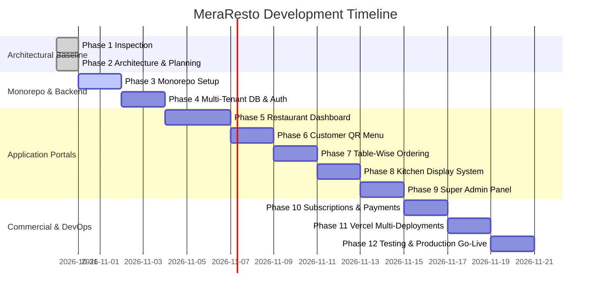

# MeraResto — Master Development Roadmap (Phases 1 to 12)
**Platform:** MeraResto Multi-Restaurant SaaS  
**Version:** 1.0.0  
**Status:** Phase 1 & 2 Completed; Ready for Phase 3 Execution  

---

## 1. Phase-by-Phase Roadmap Matrix

---

## 2. Detailed Phase Specifications

### ✅ Phase 1: Existing Project Inspection & Baseline Audit
- **Objective:** Perform complete code, dependency, database, and Vercel audit without touching existing source code.
- **Key Deliverables:** `docs/PHASE_1_INSPECTION.md`.
- **Status:** **Completed & Approved.**

---

### ✅ Phase 2: Architecture & Migration Planning
- **Objective:** Design the entire multi-tenant SaaS architecture, data models, subdomain routing, and deployment specifications.
- **Key Deliverables:**
  - `docs/PROJECT_ARCHITECTURE.md`
  - `docs/DATABASE_SCHEMA.md`
  - `docs/MIGRATION_PLAN.md`
  - `docs/PROJECT_PLAN.md`
  - `docs/FEATURES.md`
  - `docs/VERCEL_DEPLOYMENT.md`
  - `docs/DOMAIN_DNS_SETUP.md`
  - `docs/ENVIRONMENT_VARIABLES.md`
  - `docs/DEVELOPMENT_ROADMAP.md`
- **Status:** **Completed & Documented.**

---

### ⏳ Phase 3: Monorepo Setup & Package Extraction (NEXT)
- **Objective:** Initialize Turborepo and extract shared packages without breaking existing features.
- **Key Deliverables:**
  - `turbo.json` with build, lint, and dev pipeline definitions.
  - Workspace packages: `@meraresto/ui`, `@meraresto/auth`, `@meraresto/database`, `@meraresto/types`, `@meraresto/utils`.
  - Applications scaffolding in `apps/`.
- **Verification Gate:** `npm run build` runs across all packages and apps with 0 errors.

---

### ⏳ Phase 4: Authentication & Multi-Tenant Database
- **Objective:** Execute additive SQL migration for tenant isolation, RBAC, and root domain cookie authorization.
- **Key Deliverables:**
  - SQL migration script creating `profiles`, `restaurants`, `restaurant_members`, `outlets`, `dining_tables`, and `order_status_logs`.
  - Backward-compatible `hotels` view.
  - Cross-subdomain cookie session middleware (`.meraresto.in`).
- **Verification Gate:** Successful auth login on `app.meraresto.in` automatically authorizes session on `kitchen.meraresto.in`.

---

### ⏳ Phase 5: Restaurant Owner Dashboard (`apps/dashboard`)
- **Objective:** Rebrand and elevate the management dashboard under `app.meraresto.in`.
- **Key Deliverables:**
  - Multi-outlet switcher and staff management (RBAC).
  - Modernized compact menu, category, dish variant, and add-on editors.
  - Table QR generator with brand logo standee customization.
- **Verification Gate:** Restaurant owner can manage multiple branches, configure menus, and generate table QR codes seamlessly.

---

### ⏳ Phase 6: Customer QR Menu (`apps/customer-menu`)
- **Objective:** Build a lightning-fast, mobile-first digital menu deployed under `menu.meraresto.in`.
- **Key Deliverables:**
  - Instant camera scan loading (`menu.meraresto.in/[slug]?table=[number]`).
  - Dish variant selection (Regular / Large) and add-ons modal.
  - Zustand-powered mobile cart drawer with cooking notes.
- **Verification Gate:** Mobile Lighthouse Performance score >= 95.

---

### ⏳ Phase 7: Table-Wise Ordering & Secure Payment Processing
- **Objective:** Implement reliable order placement with server-side price validation.
- **Key Deliverables:**
  - Server-side price recalculation against database records.
  - Real-time order placement calling Supabase transactional functions.
  - Order tracking page (`/order/[id]`) with live status progress bar.
- **Verification Gate:** Zero client-side price tampering vulnerability; order arrives in DB in < 1 second.

---

### ⏳ Phase 8: Kitchen Display System (`apps/kitchen`)
- **Objective:** Create a dedicated, full-screen KDS under `kitchen.meraresto.in`.
- **Key Deliverables:**
  - Real-time order queue with elapsed cooking timers.
  - Sound alert chime on new orders.
  - One-tap status controls: Accept → Start Cooking → Mark Ready → Mark Served.
  - Station routing (Tandoor, Hot Kitchen, Beverages).
- **Verification Gate:** Real-time updates reflect instantaneously on both customer tracker and manager dashboard.

---

### ⏳ Phase 9: Super Admin Platform (`apps/super-admin`)
- **Objective:** Build the platform administration panel under `admin.meraresto.in`.
- **Key Deliverables:**
  - Multi-restaurant directory and tenant status overrides (Active / Suspended).
  - Subscription management and manual quota overrides.
  - Platform-wide GMV and order volume analytics.
  - System audit log inspector.
- **Verification Gate:** Platform admin can provision new tenants and inspect platform logs.

---

### ⏳ Phase 10: Subscriptions, Plans & Payments
- **Objective:** Implement SaaS monetization and quota enforcement.
- **Key Deliverables:**
  - 3 Tiers: Starter (₹299/mo), Pro (₹499/mo), Enterprise (₹999/mo).
  - Razorpay recurring billing and webhook subscription lifecycle listeners.
  - Quota enforcement (max tables, max menu items, KDS access).
- **Verification Gate:** Automated subscription upgrades and payment webhook handling.

---

### ⏳ Phase 11: Vercel Multi-Project Deployment
- **Objective:** Deploy all 5 applications on Vercel linked to `meraresto.git`.
- **Key Deliverables:**
  - 5 Vercel projects configured with individual Root Directories.
  - DNS A and CNAME records mapped for `meraresto.in` and all subdomains.
  - SSL certificate verification.
- **Verification Gate:** All 5 subdomains load with valid SSL certificates and correct application targets.

---

### ⏳ Phase 12: Testing, Security Audit & Production Launch
- **Objective:** Comprehensive end-to-end testing, security audit, and go-live.
- **Key Deliverables:**
  - Tenant isolation audit (confirming zero data leakage between restaurants).
  - End-to-end order flow testing from QR scan to kitchen serving.
  - Cutover from legacy single-app deployment.
- **Verification Gate:** Production sign-off and live customer onboarding.

---
*End of Master Development Roadmap.*

