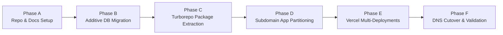

# MeraResto — Zero-Downtime Migration Plan & Transition Blueprint
**Objective:** Transition from Single-App Monolith (`qresto`) to Turborepo Monorepo (`meraresto`)  
**Deployment Target:** 5 Vercel Subdomain Projects (`*.meraresto.in`)  
**Database:** Single Supabase PostgreSQL Instance (Non-Destructive Evolution)  
**Version:** 1.0.0  

---

## 1. Migration Principles & Guarantees
1. **Zero Data Loss:** Existing restaurant accounts, digital menus, dishes, and historical orders must remain intact.
2. **Zero Downtime:** The existing production deployment on Vercel remains active until all 5 new subdomains are verified.
3. **Additive Database Migrations:** No column or table drops. All schema updates are additive with backward-compatible views.
4. **Clean Code Extraction:** Reuse existing components, stores, and API handlers in shared packages to prevent duplication.

---

## 2. Transition Phasing & Roadmap



---

## 3. Step-by-Step Migration Execution

### Phase A: Repository Alignment & Documentation (COMPLETED)
- Remote updated to official target: `https://github.com/Visionitinstitute/meraresto.git`.
- Baseline inspection report generated: `docs/PHASE_1_INSPECTION.md`.
- Architecture, schema, and migration documentation prepared in `docs/`.

### Phase B: Non-Destructive Database Evolution
- **Step B1:** Create `profiles` table and trigger to automatically populate on new `auth.users` registration.
- **Step B2:** Create `plans` table with Starter (₹299/mo), Pro (₹499/mo), and Enterprise (₹999/mo) defaults.
- **Step B3:** Create `restaurants` table and copy data from existing `hotels`:
  ```sql
  INSERT INTO public.restaurants (id, name, slug, logo_url, contact_phone, is_active, created_at)
  SELECT id, name, slug, logo_url, phone, is_active, created_at FROM public.hotels
  ON CONFLICT (id) DO NOTHING;
  ```
- **Step B4:** Establish `restaurant_members` table assigning existing `owner_id` as role `'owner'`.
- **Step B5:** Maintain backward-compatible `hotels` VIEW over `restaurants` so existing code continues functioning without runtime errors.
- **Step B6:** Create `outlets`, `dining_tables`, `item_variants`, `add_ons`, and `order_status_logs`.

### Phase C: Turborepo Monorepo Extraction
- **Step C1:** Initialize `turbo.json` with pipeline targets (`build`, `dev`, `lint`, `type-check`).
- **Step C2:** Create workspaces directory structure:
  - `packages/ui` ← Extract from `components/ui/*` and Tailwind CSS configurations.
  - `packages/types` ← Extract and expand from `types/index.ts`.
  - `packages/auth` ← Extract from `middleware.ts` and `lib/supabase/*`.
  - `packages/database` ← Extract typed client and query methods.
  - `packages/utils` ← Extract formatting, slug generation, and validation routines.
- **Step C3:** Re-link root `package.json` with workspace dependencies.

### Phase D: Application Partitioning
1. **`apps/website`:** Extract landing page (`app/page.tsx`), marketing components (`components/landing/*`), and SEO metadata.
2. **`apps/dashboard`:** Extract manager routes (`/dashboard/*`), menu editor, QR generator, staff settings.
3. **`apps/customer-menu`:** Extract mobile menu (`/menu/[slug]/*`), checkout flow, and live order status tracker (`/order/[id]`).
4. **`apps/kitchen`:** Upgrade live orders view into a dedicated full-screen Kitchen Display System (KDS) with sound triggers, timers, and station routing.
5. **`apps/super-admin`:** Implement platform administration portal for tenant provisioning, subscription monitoring, and audit logging.

### Phase E: Vercel Multi-Project Deployment
- Connect the GitHub repository `meraresto.git` to 5 distinct Vercel projects:
  - `meraresto-website` (Root: `apps/website`)
  - `meraresto-dashboard` (Root: `apps/dashboard`)
  - `meraresto-customer-menu` (Root: `apps/customer-menu`)
  - `meraresto-kitchen` (Root: `apps/kitchen`)
  - `meraresto-super-admin` (Root: `apps/super-admin`)
- Configure Monorepo environment variables and Turborepo remote caching on Vercel.

### Phase F: Domain & DNS Cutover
- Add custom domains on Vercel:
  - `meraresto.in` & `www.meraresto.in` → `meraresto-website`
  - `app.meraresto.in` → `meraresto-dashboard`
  - `menu.meraresto.in` → `meraresto-customer-menu`
  - `kitchen.meraresto.in` → `meraresto-kitchen`
  - `admin.meraresto.in` → `meraresto-super-admin`
- Set DNS CNAME records to `cname.vercel-dns.com` and A records to `76.76.21.21`.
- Verify SSL certificate issuance and cookie domain traversal (`.meraresto.in`).

---

## 4. Rollback & Disaster Recovery Triggers

| Incident Trigger | Immediate Action |
| :--- | :--- |
| **New deployment fails during testing** | Traffic remains directed to existing single-app Vercel deployment URL until preview build is 100% verified. |
| **Database migration syntax error** | All migration scripts are wrapped in `BEGIN ... COMMIT` blocks; roll back transaction automatically on failure. |
| **Subdomain cookie authorization failure** | Fallback to explicit bearer token authentication in request headers until cookie domain DNS propagates. |

---
*End of Migration Plan.*
