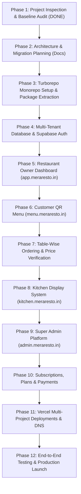

# Phase 1: Existing Project Inspection & Baseline Report
**Project Name:** MeraResto (formerly QResto)  
**Document Version:** 1.0.0  
**Date:** 2026-10-30  
**Author:** Senior Full-Stack Architect, SaaS Product Engineer & DevOps Engineer  
**Status:** Completed (Phase 1 Baseline Audit)

---

## Executive Summary
This document provides a comprehensive technical audit and architectural inspection of the existing single-tenant/monolithic restaurant QR menu and ordering system. The objective is to establish the baseline for transforming the current application into **MeraResto**, an enterprise-grade, multi-tenant restaurant SaaS platform powered by a Turborepo Monorepo and deployed across 5 dedicated subdomains on Vercel with a single unified Supabase PostgreSQL backend.

In accordance with strict Phase 1 instructions, **no project source code files were modified** during this audit.

---

## 1. Current Folder Structure

The existing project is structured as a **single Next.js App Router monolith**:

```
qresto/
├── app/                                    # Next.js 16 App Router Directory
│   ├── api/                                # Backend API Routes
│   │   ├── auth/
│   │   │   └── qr-session/route.ts         # QR token session verification
│   │   └── orders/route.ts                 # Customer order creation & notification
│   ├── dashboard/                          # Restaurant Manager Portal
│   │   ├── menu/page.tsx                   # Menu & category management
│   │   ├── orders/page.tsx                 # Live orders & status transitions
│   │   ├── qr/page.tsx                     # Table QR generation & printing
│   │   ├── reviews/page.tsx                # Customer reviews & ratings
│   │   ├── settings/page.tsx               # Restaurant profile & metadata
│   │   ├── layout.tsx                      # Dashboard sidebar & top navigation
│   │   └── page.tsx                        # Dashboard KPI overview
│   ├── login/                              # Authentication: Sign In
│   │   ├── qr-auth/page.tsx                # Mobile QR quick login
│   │   └── page.tsx                        # Email & password login
│   ├── menu/[slug]/                        # Public Customer QR Digital Menu
│   │   ├── checkout/                       # Cart review & table ordering
│   │   │   ├── CheckoutClient.tsx
│   │   │   └── page.tsx
│   │   └── page.tsx                        # Dynamic menu per restaurant slug
│   ├── order/[id]/                         # Real-Time Order Tracking & Review
│   │   ├── OrderStatusClient.tsx
│   │   └── page.tsx
│   ├── signup/page.tsx                     # Restaurant Owner Registration
│   ├── test-db/page.tsx                    # Supabase database connectivity test
│   ├── favicon.ico
│   ├── globals.css                         # Tailwind CSS v4 directives & theme
│   ├── layout.tsx                          # Root HTML & metadata shell
│   └── page.tsx                            # Marketing Landing Page
├── components/                             # Reusable Component Library
│   ├── auth/
│   │   └── QRLoginCard.tsx                 # QR session login modal
│   ├── landing/                            # Landing page sections
│   │   ├── CTASection.tsx                  # Call to action section
│   │   ├── HeroMockup.tsx                  # Interactive app preview
│   │   ├── HeroSection.tsx                 # Hero value proposition
│   │   ├── HowItWorks.tsx                  # 3-step setup walkthrough
│   │   ├── InteractiveTabsDemo.tsx         # Guest/Kitchen/Analytics tab demo
│   │   ├── KeyFeatures.tsx                 # Feature cards grid
│   │   ├── LandingFooter.tsx               # Site links & legal footer
│   │   ├── LandingNavbar.tsx               # Navigation bar with user profile
│   │   ├── PricingSection.tsx              # Starter / Pro / Enterprise pricing
│   │   ├── RestaurantBenefits.tsx          # ROI & operational benefits
│   │   ├── StatsBanner.tsx                 # Metric proof counters
│   │   └── TestimonialsSection.tsx         # Partner restaurant reviews
│   ├── menu/
│   │   └── CustomerMenuView.tsx            # Digital menu layout & category drawer
│   ├── public/
│   │   └── QuickMenuFinder.tsx             # Table selector widget
│   └── ui/                                 # Base UI Components (shadcn/ui style)
│       ├── Badge.tsx                       # Status & dietary pills
│       ├── Button.tsx                      # Interactive button with states
│       ├── Card.tsx                        # Container card
│       ├── Input.tsx                       # Form text input
│       ├── Modal.tsx                       # Accessible dialog wrapper
│       ├── Spinner.tsx                     # SVG loading indicator
│       └── Toast.tsx                       # Alert notification
├── lib/
│   └── supabase/                           # Supabase Client Configurations
│       ├── client.ts                       # Browser client (createBrowserClient)
│       └── server.ts                       # Server client with cookies (createServerClient)
├── public/                                 # Static Assets
│   ├── order-chime.mp3                     # Audio notification for kitchen orders
│   └── images...
├── store/                                  # Global Client State Management
│   └── useCartStore.ts                     # Zustand persistent cart store
├── supabase/                               # Database Schemas & Migrations
│   ├── schema.sql                          # Core DDL, indexes, RLS policies
│   └── seed.sql                            # Sample initial data
├── types/                                  # TypeScript Definitions
│   └── index.ts                            # Core data interfaces
├── .env.example                            # Template environment variables
├── .env.local                              # Active local secrets (Supabase credentials)
├── .gitignore                              # Git exclusion rules
├── AGENTS.md                               # Next.js development rules
├── eslint.config.mjs                       # ESLint 9 configuration
├── middleware.ts                           # Next.js route protection & session sync
├── next.config.ts                          # Next.js 16 Turbopack configuration
├── package.json                            # Dependencies & build scripts
└── tsconfig.json                           # TypeScript compiler configuration
```

---

## 2. Existing Technology Stack

| Layer | Existing Technology | Version | Purpose in MeraResto |
| :--- | :--- | :--- | :--- |
| **Framework** | Next.js (App Router) | `16.4.3` | Turbopack compilation across all 5 apps |
| **Core UI Runtime** | React & React-DOM | `19.3.0` | Latest React 19 concurrent features |
| **Language** | TypeScript | `^5.0` | Strict type safety across apps & packages |
| **Styling** | Tailwind CSS | `^4.0` | Utility CSS with `@tailwindcss/turbopack` |
| **Icons** | Lucide React | `^1.61.0` | Modern, clean vector iconography |
| **QR Code Engine** | qrcode.react | `^4.2.0` | Client-side QR generation & canvas export |
| **Client State** | Zustand | `^5.0.16` | Mobile cart & order state synchronization |
| **Backend & DB** | Supabase PostgreSQL | Latest | Cloud PostgreSQL with Row Level Security |
| **Auth** | Supabase SSR Auth | `@supabase/ssr ^0.12.7` | Cookie-based session verification |
| **Realtime** | Supabase Realtime | `@supabase/supabase-js ^2.118.0` | Kitchen display & customer order websocket channels |
| **Deployment** | Vercel | Production | Serverless & Edge deployment platform |
| **Monorepo Engine** | *To be introduced in Phase 3* | Turborepo | High-performance build orchestrator |

---

## 3. Current Vercel Configuration

1. **Current Project Model:** Single Vercel Project. The entire monolith (marketing page, customer menu, dashboard, order tracking, and APIs) deploys under a single Vercel deployment URL.
2. **Configuration File:** No `vercel.json` exists in the repository root. Vercel relies completely on Next.js auto-detection.
3. **Root Directory:** Default `./` (repository root).
4. **Build Command:** `next build` (using Turbopack).
5. **Output Directory:** `.next`
6. **Environment Variables Active in Vercel:**
   - `NEXT_PUBLIC_SUPABASE_URL`
   - `NEXT_PUBLIC_SUPABASE_ANON_KEY`
   - `NEXT_PUBLIC_SITE_URL`

---

## 4. GitHub Integration Status

- **Previous Remote Origin:** `https://github.com/Visionitinstitute/QResto.git`
- **Target Repository (MeraResto):** `https://github.com/Visionitinstitute/meraresto.git`
- **Current Active Branch:** `main`
- **Working Tree Status:** Clean, verified with zero build errors (`npm run build` exits with code 0 across 15 routes).
- **Migration Strategy:** The current repository will be connected to the new remote `meraresto.git` without losing historical commits.

---

## 5. Existing Implemented Features

### A. Marketing Website (`app/page.tsx`)
- Navigation header with auth detection and profile menu.
- Interactive hero section showcasing live digital menu previews.
- Real-time ecosystem tabs (Customer View, Kitchen View, Analytics).
- Key operational features for restaurants.
- Pricing structure with monthly and annual toggles.
- Customer testimonials and social proof.
- FAQ section and conversion footer.

### B. Restaurant Owner Dashboard (`app/dashboard/*`)
- **KPI Metrics:** Live tracking of today's orders, today's gross sales, pending order count, and average guest rating.
- **Live Kitchen Orders (`/dashboard/orders`):**
  - Instant order ingestion via Supabase Realtime websocket.
  - Audio alert chime (`order-chime.mp3`) with live toggle button.
  - Granular order status workflow: `pending` → `accepted` → `preparing` → `ready` → `served` (or `rejected`).
  - Itemized dish breakdown, special instructions, and customer phone numbers.
- **Menu & Category Management (`/dashboard/menu`):**
  - Category creation, reordering, and deletion.
  - Dish catalog management (name, description, price, image URL, veg/non-veg badge, in-stock/sold-out toggle).
  - Inline price editing directly within the menu table.
- **Table QR Management (`/dashboard/qr`):**
  - Generation of unique table-mapped QR codes.
  - General reception/counter QR code for table-agnostic orders.
  - Single-click PNG download.
  - Print-ready card grid for acrylic standees.
- **Review & Rating Feed (`/dashboard/reviews`):**
  - Aggregated restaurant rating score.
  - Chronological customer feedback list.
- **Restaurant Settings (`/dashboard/settings`):**
  - Restaurant business name, permanent menu slug, contact phone, physical address, and active toggle.

### C. Customer Digital QR Menu (`app/menu/[slug]/*`)
- Instant loading via camera scan on any mobile device (zero app download required).
- Restaurant branding with logo, address, and live operational status.
- Category filtering, dynamic search, and veg/non-veg filter toggle.
- Item detail cards with dish descriptions, prices, and photo previews.
- Zustand-powered cart drawer with quantity increments, cooking instructions input, and table number assignment.
- Fast checkout flow (`/menu/[slug]/checkout`) calling `/api/orders`.

### D. Live Order Status Tracker (`app/order/[id]/*`)
- Real-time customer order tracker subscribing to Supabase status changes.
- Visual step progression: Order Placed → Accepted → In the Kitchen → Ready to Serve → Served.
- Interactive 5-star rating and written review submission upon completion.

---

## 6. Supabase Integration Status

### Existing Schema (`supabase/schema.sql`):
1. **`hotels`:** Restaurant profile table (`id`, `owner_id`, `name`, `slug`, `logo_url`, `address`, `phone`, `is_active`, `created_at`).
2. **`categories`:** Menu categories (`id`, `hotel_id`, `name`, `sort_order`, `created_at`).
3. **`menu_items`:** Dishes (`id`, `hotel_id`, `category_id`, `name`, `description`, `price`, `image_url`, `is_veg`, `is_available`, `created_at`).
4. **`tables`:** Physical dining tables (`id`, `hotel_id`, `table_number`, `created_at`).
5. **`orders`:** Customer orders (`id`, `hotel_id`, `table_number`, `customer_name`, `customer_phone`, `note`, `total_amount`, `status`, `created_at`).
6. **`order_items`:** Items within each order (`id`, `order_id`, `menu_item_id`, `item_name`, `price`, `quantity`, `created_at`).
7. **`reviews`:** Guest reviews (`id`, `hotel_id`, `order_id`, `customer_name`, `rating`, `comment`, `created_at`).

### Current Security & RLS Policies:
- Row Level Security (RLS) is enabled on all tables.
- Public read access is granted for active restaurants, categories, menu items, and tables.
- Write access is restricted to authenticated owners matching `auth.uid() = owner_id`.
- Anon insertion is permitted for `orders` and `order_items` to allow friction-free guest ordering.

### Gaps for Enterprise Multi-Tenant SaaS:
1. **Naming Standard:** Uses `hotels` / `hotel_id` instead of SaaS standard `restaurants` / `restaurant_id`.
2. **Multi-Location Support:** Lacks an `outlets` table for multi-branch restaurant chains.
3. **Role-Based Access Control (RBAC):** Lacks `restaurant_members` table; only one owner is permitted per restaurant. Staff (chefs, waitstaff, accountants) cannot have scoped permissions.
4. **Monetization & Subscriptions:** No `plans` or `subscriptions` tables to enforce feature limits (e.g. max tables, max menu items).
5. **Server-Side Price Validation:** Currently, total order calculation in `/api/orders` trusts the price sent from the client cart. Server-side validation against current menu item records must be enforced.

---

## 7. Migration Requirements

1. **Brand & Identity Transformation:**
   - Global rebranding from **QResto** to **MeraResto**.
   - Official Tagline: *"Your Restaurant, Your Digital World."*
   - Color palette upgrade: Minimalist clean white/warm neutral canvas with deep navy (`#0B192C` / `#1E3E62`) and professional teal (`#008080` / `#0E8388`) accents.
2. **Monorepo Extraction:**
   - Migrate from monolithic root into Turborepo workspace packages.
   - Separate concerns cleanly into 5 frontend apps and 5 shared packages.
3. **Subdomain Architecture:**
   - `meraresto.in` — Marketing & Lead Generation
   - `app.meraresto.in` — Restaurant Owner & Manager Dashboard
   - `menu.meraresto.in` — Customer Mobile QR Menu & Ordering
   - `kitchen.meraresto.in` — Dedicated Kitchen Display System (KDS)
   - `admin.meraresto.in` — Super Admin & Platform Operations
4. **Unified Auth & Cross-Subdomain Session:**
   - Configure Supabase Auth cookie domain to `.meraresto.in` so restaurant owners and staff can seamlessly authenticate across `app.meraresto.in` and `kitchen.meraresto.in`.
5. **Database Evolution (Non-Destructive):**
   - Provide an additive migration that introduces `restaurants`, `restaurant_members`, `subscriptions`, `plans`, and backward-compatible views for existing records.

---

## 8. Recommended Monorepo Architecture

```
meraresto/
├── apps/
│   ├── website/                      # Marketing Website (meraresto.in)
│   │   ├── app/
│   │   ├── package.json
│   │   └── next.config.ts
│   ├── dashboard/                    # Restaurant Owner Dashboard (app.meraresto.in)
│   │   ├── app/
│   │   ├── package.json
│   │   └── next.config.ts
│   ├── customer-menu/                # Customer QR Menu (menu.meraresto.in)
│   │   ├── app/
│   │   ├── package.json
│   │   └── next.config.ts
│   ├── kitchen/                      # Kitchen Display System - KDS (kitchen.meraresto.in)
│   │   ├── app/
│   │   ├── package.json
│   │   └── next.config.ts
│   └── super-admin/                  # Platform Super Admin (admin.meraresto.in)
│       ├── app/
│       ├── package.json
│       └── next.config.ts
├── packages/
│   ├── ui/                           # Shared UI Component Library (Buttons, Cards, Inputs, Dialogs)
│   │   ├── components/
│   │   ├── styles/
│   │   └── package.json
│   ├── auth/                         # Supabase Auth Handlers, SSR Middleware, Cookie Helpers
│   │   ├── src/
│   │   └── package.json
│   ├── database/                     # Supabase Client, Migrations, Seed Data, Query Helpers
│   │   ├── src/
│   │   └── package.json
│   ├── types/                        # Unified TypeScript Definitions (Tenant, Menu, Order, RBAC)
│   │   ├── src/
│   │   └── package.json
│   └── utils/                        # Shared Utilities (Formatting, Currency, Validations, Slugify)
│       ├── src/
│       └── package.json
├── docs/                             # Complete Architecture & Deployment Documentation
├── turbo.json                        # Turborepo Build & Pipeline Configuration
├── package.json                      # Root Workspace Configuration (npm/pnpm workspaces)
└── .gitignore
```

---

## 9. Potential Technical Risks & Mitigation Plan

| Risk | Impact | Likelihood | Mitigation Strategy |
| :--- | :--- | :--- | :--- |
| **Existing Data Loss during DB Schema Upgrade** | Critical | Low | Implement additive schema migrations; use PostgreSQL views (`hotels` alias view over `restaurants`) to prevent breaking existing foreign keys. |
| **Cross-Subdomain Session Drops** | High | Medium | Configure Supabase Auth cookie attribute with `domain: '.meraresto.in'` and `SameSite: 'Lax'` across all apps. |
| **Turborepo Dependency Hoisting Issues with React 19** | Medium | Medium | Pin exact peer dependency versions of `react@19.3.0` and `next@16.4.3` in root `package.json` and package workspaces. |
| **Client-Side Order Price Tampering** | High | Low | Refactor `/api/orders` to recalculate every item price against database `menu_items` before saving the order record. |
| **Vercel Build Cache & Monorepo Root Directory Errors** | Medium | Medium | Configure each Vercel app with its specific Root Directory (`apps/website`, `apps/dashboard`, etc.) and set the Turborepo remote caching token. |
| **Supabase Realtime Connection Exhaustion** | Medium | Low | Use row-level filtered channels (`channel: 'restaurant-orders:${restaurantId}'`) instead of broadcasting table-wide mutations. |

---

## 10. Step-by-Step Implementation Plan (Phases 1 to 12)



- **Phase 1: Existing Project Inspection (COMPLETED):** Deep codebase audit, dependency mapping, data flow analysis, and risk assessment without touching application source files.
- **Phase 2: Architecture & Migration Planning:** Author all required documentation in `docs/` (`PROJECT_ARCHITECTURE.md`, `DATABASE_SCHEMA.md`, `MIGRATION_PLAN.md`, `VERCEL_DEPLOYMENT.md`, etc.).
- **Phase 3: Monorepo Setup:** Initialize Turborepo, configure root workspace, extract shared packages (`@meraresto/ui`, `@meraresto/database`, `@meraresto/types`, `@meraresto/auth`, `@meraresto/utils`).
- **Phase 4: Multi-Tenant Database & Auth:** Execute SQL migrations for tenant isolation (`restaurant_id`), RBAC, and root domain cookie authentication.
- **Phase 5: Restaurant Dashboard (`apps/dashboard`):** Port and elevate management portal with multi-outlet switcher, staff invites, and enhanced reports.
- **Phase 6: Customer QR Menu (`apps/customer-menu`):** Mobile-first digital menu deployed under `menu.meraresto.in/[slug]?table=[number]`.
- **Phase 7: Table Ordering Engine:** Server-side price calculation, cart validation, and order placement.
- **Phase 8: Kitchen Display System (`apps/kitchen`):** Fullscreen KDS with sound alerts, cooking timers, and one-tap status updates.
- **Phase 9: Super Admin (`apps/super-admin`):** Platform analytics, restaurant onboarding, tenant suspension/activation, and billing oversight.
- **Phase 10: Subscriptions & Payments:** Pricing tiers, Razorpay integration, invoice generation, and quota enforcement.
- **Phase 11: Vercel Multi-Project Deployment:** Configure 5 Vercel projects pointing to the single monorepo, setup custom domain DNS records, and SSL verification.
- **Phase 12: Verification & Production Launch:** Security audit, penetration testing, load testing, and go-live.

---
*End of Phase 1 Inspection Report. Awaiting user approval to proceed to Phase 2.*

