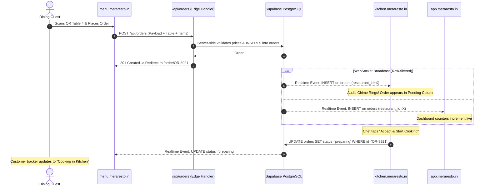

# MeraResto — System Architecture & Target Design Specification
**Product:** MeraResto — Multi-Restaurant SaaS Platform  
**Tagline:** *Your Restaurant, Your Digital World.*  
**Author:** Senior Full-Stack Architect, SaaS Product Engineer & DevOps Engineer  
**Version:** 2.0.0  
**Status:** Approved Architectural Blueprint  

---

## 1. Architectural Vision & Core Concept
**MeraResto** is a cloud-native, multi-tenant Software-as-a-Service (SaaS) platform engineered for modern hospitality businesses. It enables independent restaurants, cafes, cloud kitchens, and multi-outlet dining chains to effortlessly manage their complete digital operations—from customer table-side QR scanning and real-time ordering to kitchen display synchronization, billing, and platform-wide analytics.

### Key Architectural Pillars:
1. **Multi-Tenant Isolation:** Complete data partitioning at the database level using PostgreSQL Row Level Security (RLS) keyed on `restaurant_id`.
2. **Subdomain-Centric Application Suite:** Clear separation of user personas through five dedicated applications running on distinct subdomains.
3. **Turborepo Monorepo Architecture:** Zero duplicate code. Shared UI primitives, typed database contracts, unified auth helpers, and shared utilities across all applications.
4. **Resilient Real-Time Operations:** Sub-second latency for kitchen order delivery and customer status tracking via Supabase Realtime websocket channels.
5. **Zero Friction Guest Experience:** Fast, responsive, mobile-first customer menu requiring **zero app downloads and zero sign-ups**.

---

## 2. Target Application Topology & Subdomain Mapping

```mermaid
flowchart TD
    DNS["Cloudflare / Domain DNS (*.meraresto.in)"] --> WEB["meraresto.in\n(apps/website)"]
    DNS --> DASH["app.meraresto.in\n(apps/dashboard)"]
    DNS --> MENU["menu.meraresto.in\n(apps/customer-menu)"]
    DNS --> KDS["kitchen.meraresto.in\n(apps/kitchen)"]
    DNS --> ADMIN["admin.meraresto.in\n(apps/super-admin)"]

    subgraph Shared Monorepo Core ["packages/*"]
        UI["@meraresto/ui"]
        AUTH["@meraresto/auth"]
        DB["@meraresto/database"]
        TYPES["@meraresto/types"]
        UTILS["@meraresto/utils"]
    end

    WEB --> Shared Monorepo Core
    DASH --> Shared Monorepo Core
    MENU --> Shared Monorepo Core
    KDS --> Shared Monorepo Core
    ADMIN --> Shared Monorepo Core

    Shared Monorepo Core --> SUPA[("Supabase PostgreSQL\n+ RLS + Realtime + Storage")]
```

| Subdomain | Target App | Target Audience | Key Responsibilities |
| :--- | :--- | :--- | :--- |
| `meraresto.in` | `apps/website` | General Public, Prospective Restaurant Owners | Marketing, product demo, feature showcase, pricing plans, SEO pages, lead capture. |
| `app.meraresto.in` | `apps/dashboard` | Restaurant Owners, Managers, Admins | Menu catalog CRUD, QR code generation, live orders, sales reports, table layouts, staff management, settings. |
| `menu.meraresto.in` | `apps/customer-menu` | Dining Guests (Dine-in, Takeaway) | Mobile QR menu browsing, allergen filters, cart management, table-mapped order placement, live status tracking. |
| `kitchen.meraresto.in` | `apps/kitchen` | Chefs, Line Cooks, Kitchen Expeditors | Kitchen Display System (KDS), real-time order queue, sound alerts, cooking timers, status transitions. |
| `admin.meraresto.in` | `apps/super-admin` | MeraResto Platform Operations Team | Tenant provisioning, subscription & plan management, revenue analytics, platform health, tenant audit logs. |

---

## 3. Monorepo Structure (`meraresto/`)

The platform is organized using **Turborepo** with npm/pnpm workspaces:

```
meraresto/
├── apps/
│   ├── website/                      # Public marketing site (meraresto.in)
│   │   ├── app/                      # App router: home, pricing, features, demo, contact
│   │   ├── public/                   # Marketing assets, logos, screenshots
│   │   ├── package.json
│   │   └── next.config.ts
│   ├── dashboard/                    # Restaurant portal (app.meraresto.in)
│   │   ├── app/                      # App router: /menu, /orders, /tables, /qr, /analytics, /staff, /settings
│   │   ├── public/                   # Dashboard assets, sound chimes
│   │   ├── package.json
│   │   └── next.config.ts
│   ├── customer-menu/                # Customer QR menu (menu.meraresto.in)
│   │   ├── app/                      # App router: /[slug] (menu), /[slug]/checkout, /order/[id]
│   │   ├── package.json
│   │   └── next.config.ts
│   ├── kitchen/                      # Kitchen Display System (kitchen.meraresto.in)
│   │   ├── app/                      # App router: /live-kds, /station/[stationId], /history
│   │   ├── package.json
│   │   └── next.config.ts
│   └── super-admin/                  # Platform operations (admin.meraresto.in)
│       ├── app/                      # App router: /tenants, /subscriptions, /analytics, /logs
│       ├── package.json
│       └── next.config.ts
├── packages/
│   ├── ui/                           # Shared UI Component Library
│   │   ├── components/               # Button, Input, Modal, Badge, Card, Table, Drawer, Toast
│   │   ├── styles/                   # Tailwind CSS presets, theme tokens
│   │   └── package.json
│   ├── auth/                         # Unified Supabase Auth Library
│   │   ├── src/                      # SSR cookie middleware, session validation, RBAC helpers
│   │   └── package.json
│   ├── database/                     # Database Access Layer
│   │   ├── src/                      # Typed Supabase client, queries, mutations, migrations
│   │   └── package.json
│   ├── types/                        # Core TypeScript Domain Models
│   │   ├── src/                      # Restaurant, Menu, Order, KDS, Tenant, Billing types
│   │   └── package.json
│   └── utils/                        # Shared Utilities
│       ├── src/                      # Currency formatters, slugifiers, date math, validation schemas
│       └── package.json
├── docs/                             # Complete Architectural & Operational Documentation
├── turbo.json                        # Turborepo task pipeline configuration
├── package.json                      # Monorepo root package definition
└── tsconfig.base.json                # Base TypeScript compiler options
```

---

## 4. Shared Packages Specification

### A. `@meraresto/ui`
A unified component system built on clean Tailwind CSS utility classes and Radix UI / headless primitives.
- **Design System Tokens:** Clean white and warm neutral backgrounds (`#FBFBFB`, `#F4F4F5`, `#FFFFFF`), deep navy brand anchors (`#0B192C`, `#1E3E62`), and high-trust teal accents (`#008080`, `#0E8388`).
- **Core Components:** `Button`, `Input`, `Card`, `Badge`, `Modal`, `Drawer`, `Spinner`, `Toast`, `Table`, `DropdownMenu`, `Tabs`.

### B. `@meraresto/auth`
Centralized authentication routines wrapping `@supabase/ssr`:
- Cross-subdomain session synchronization using wildcard cookies (`.meraresto.in`).
- Server-side route protection middlewares for manager dashboard, kitchen station, and super admin.
- Role-Based Access Control (RBAC) helpers (`hasPermission(user, 'menu.edit')`, `isRole(user, 'chef')`).

### C. `@meraresto/database`
Strict typed database client encapsulating Supabase PostgreSQL interactions:
- Strongly typed query builders ensuring `restaurant_id` is applied to every read and write.
- Server-side stored procedures and transactional order placement.
- Automated migrations and seed runners.

### D. `@meraresto/types`
The single source of truth for all domain entities:
- Multi-Tenant Entities: `Restaurant`, `Outlet`, `RestaurantMember`, `SubscriptionPlan`.
- Catalog Entities: `Category`, `MenuItem`, `ItemVariant`, `AddOn`.
- Order & Kitchen Entities: `DiningTable`, `QRCode`, `Order`, `OrderItem`, `OrderStatus`, `KDSStation`.
- Super Admin Entities: `PlatformMetric`, `AuditLog`, `PaymentRecord`.

### E. `@meraresto/utils`
Shared business logic:
- `formatCurrency(amount, currencyCode)` (e.g. ₹ INR, $ USD, etc.).
- `slugify(restaurantName)` (generating sanitized, collision-free slugs).
- Order state machine validators (ensuring valid status transition chains).
- Zod schemas for order creation, restaurant registration, and item validation.

---

## 5. Cross-Subdomain Authentication & Session Flow

```mermaid
sequenceDiagram
    autonumber
    actor Owner as Restaurant Owner
    participant App as app.meraresto.in
    participant SupaAuth as Supabase Auth
    participant KDS as kitchen.meraresto.in

    Owner->>App: Submits Email & Password
    App->>SupaAuth: signInWithPassword(email, password)
    SupaAuth-->>App: Auth Session (Access Token + Refresh Token)
    App-->>Owner: Sets HTTP-Only Cookie with Domain=.meraresto.in
    Note over Owner,App: Cookie: sb-access-token; Domain=.meraresto.in; SameSite=Lax; Secure

    Owner->>KDS: Opens kitchen.meraresto.in
    Note over Owner,KDS: Browser automatically attaches .meraresto.in cookie
    KDS->>SupaAuth: getUser() via SSR Middleware
    SupaAuth-->>KDS: Verified User (Role: Restaurant Member)
    KDS-->>Owner: Kitchen Display Interface Loaded Seamlessly
```

### Key Security Guardrails:
1. **Cookie Domain Scope:** Session cookies are set with `Domain=.meraresto.in` and `SameSite=Lax`.
2. **Role Verification:** Although the cookie is shared across subdomains, each app's middleware validates specific claims:
   - `apps/dashboard` requires role `owner` or `manager`.
   - `apps/kitchen` requires role `owner`, `manager`, or `chef`.
   - `apps/super-admin` requires super admin claim `is_platform_admin = true`.
   - `apps/customer-menu` is fully public (anonymous guest session or unauthenticated).

---

## 6. Real-Time Order Pub/Sub Pipeline



---

## 7. Security & Compliance Architecture

1. **PostgreSQL Row Level Security (RLS):**
   - Every single tenant-owned query is filtered by `restaurant_id`.
   - RLS checks membership in `restaurant_members` table against `auth.uid()`.
2. **Server-Side Price Recalculation:**
   - Client applications never dictate line item prices.
   - The ordering API reads authoritative pricing directly from `menu_items` and `item_variants` tables to calculate subtotal, taxes, and final total.
3. **QR Table Cryptographic Signing:**
   - Table QR codes embed signed query parameters or immutable table tokens to prevent guest spoofing of table numbers.
4. **Credential Isolation:**
   - `SUPABASE_SERVICE_ROLE_KEY` is strictly confined to secure server-side APIs (super admin provisioning and webhook handlers) and is **never** bundled into client code.

---
*End of Project Architecture Specification.*
